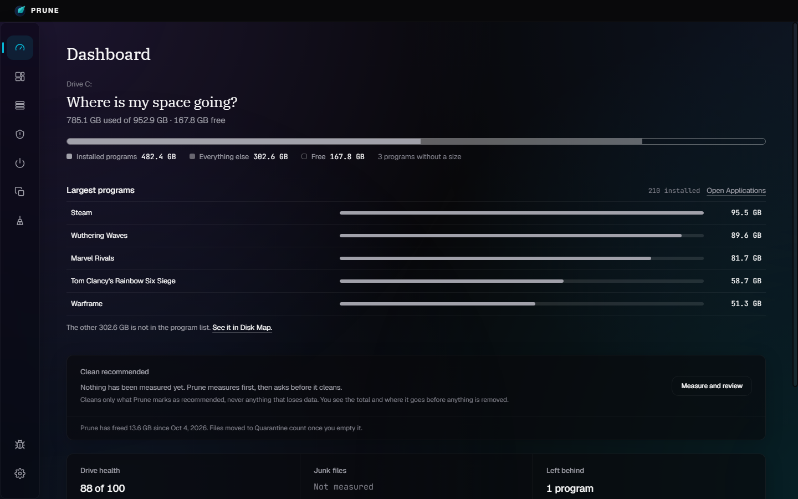
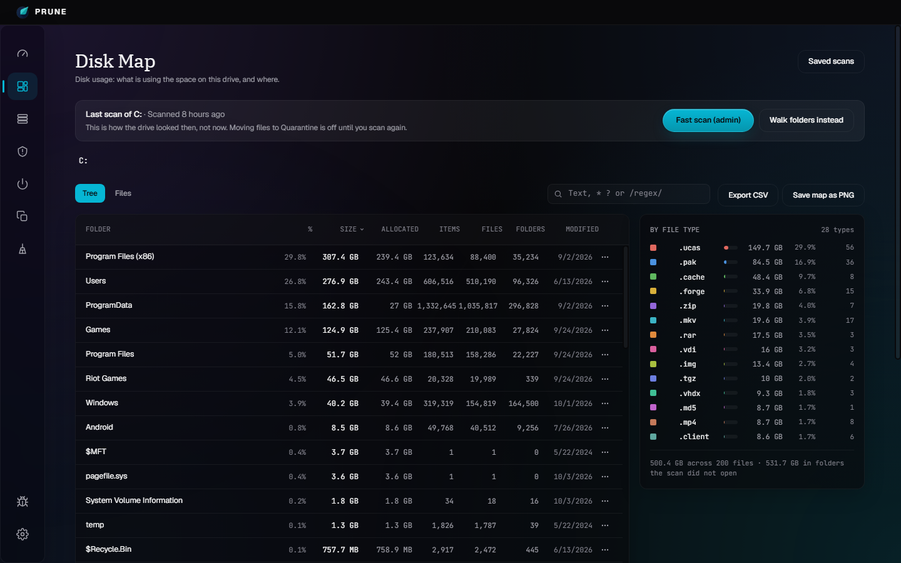
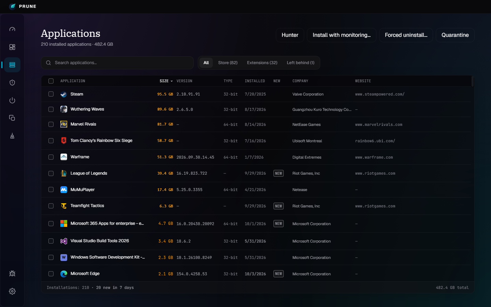
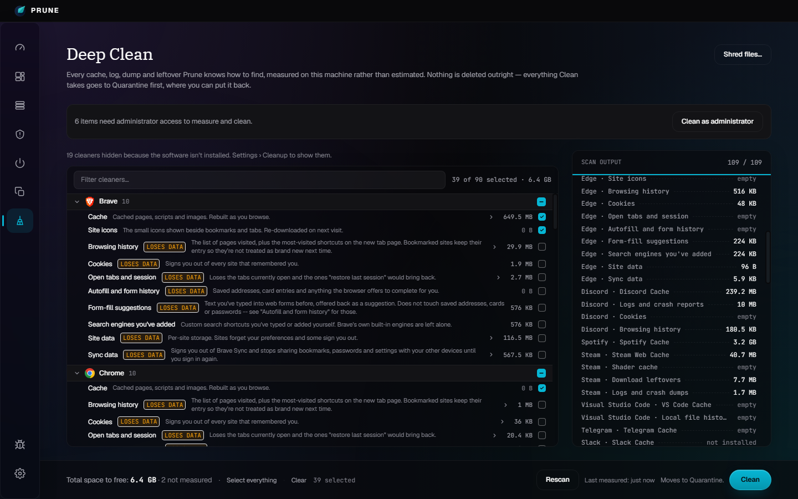
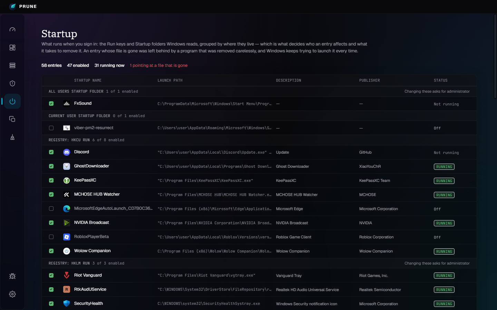
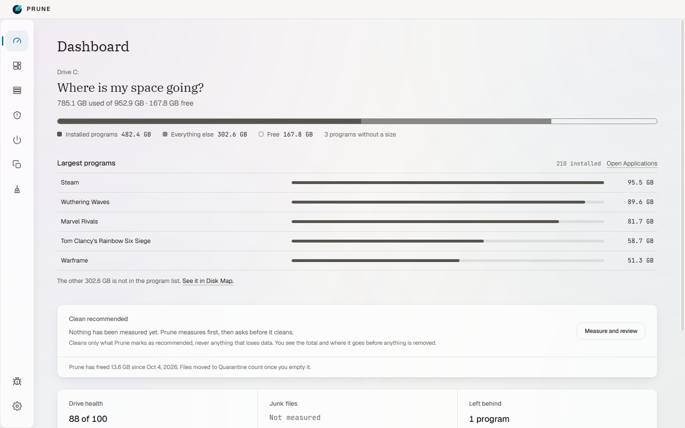

<div align="center">


# Prune

**Find out where your disk space went, and get it back.**<br/>
An uninstaller, disk map, cleaner and drive-health check for Windows 10 and 11. Free, open source, nothing sent anywhere.

[](https://github.com/jimman0I/prune/releases/latest)
[](https://github.com/jimman0I/prune/releases)
[](https://github.com/jimman0I/prune/actions/workflows/build.yml)
[](LICENSE)

[Download](https://github.com/jimman0I/prune/releases/latest) · [Quick start](#quick-start) · [Report a bug](https://github.com/jimman0I/prune/issues/new)

<picture>
  <source media="(prefers-color-scheme: dark)" srcset="docs/screenshots/dashboard-dark.png" />
  <source media="(prefers-color-scheme: light)" srcset="docs/screenshots/dashboard-light.png" />
  
</picture>

</div>

## What it does

Prune puts the jobs you'd otherwise need several tools for in one window:

- **Applications.** Every installed program, including Store apps, Chocolatey packages, browser extensions and folders nothing registered claims. Runs the program's own uninstaller, then scans for the files, registry keys and scheduled tasks it left behind.
- **Disk Map.** A treemap of a whole drive, read straight from the NTFS file table, with the largest files, size on disk, search, export, and saved scans to compare later.
- **Deep Clean.** 129 cleaner rules in 44 categories (browsers, Windows caches, apps), each showing the space it would really free on your PC. Rules for software you don't have are hidden.
- **Drive health.** Real SMART data from the drive: wear, power-on hours and errors.
- **Startup, Duplicates, Quarantine.** Turn off what runs at sign-in, find duplicate files, and undo removals.

It's in 40 languages.

<a id="what-sets-prune-apart"></a>

## What's different about it

- **Install with monitoring.** Install a program through Prune and it records what the installer changed, so a later uninstall removes exactly that.
- **One undo for a whole uninstall.** Leftover files, registry keys and scheduled tasks go to Quarantine together and come back together. Nothing is deleted outright unless you choose that in Settings.
- **Careful by default.** Leftovers start unticked, results are graded *certain / likely / possible*, and Windows, Microsoft components and other programs' folders are never offered.
- **Honest numbers.** Sizes are measured on your disk, not estimated. When Prune can't measure something it says why instead of showing `0 B`.
- **Batch uninstalls without clicking through wizards.** It uses the vendor's silent option where one exists; otherwise it can answer the wizard for you, and hands it back when a question is really yours.

## Screens

<table>
<tr>
<td colspan="2"></td>
</tr>
<tr>
<td width="50%"></td>
<td width="50%"></td>
</tr>
<tr>
<td width="50%"></td>
<td width="50%"></td>
</tr>
</table>

<a id="quick-start"></a>

## Quick start

1. Download `Prune-Setup-<version>.exe` from the [latest release](https://github.com/jimman0I/prune/releases/latest).
2. Run it. Windows will show a SmartScreen warning because Prune isn't code-signed yet: click **More info**, then **Run anyway**. (Why, and how to check the file, is below.)
3. Open Prune and pick a program under **Applications**, or start with **Disk Map**.

The `-win.zip` on the same page is the same app without an installer. Updates are off until you turn them on in Settings; after that, one click installs a new version.

<details>
<summary><b>Checking the download</b></summary>

<br/>

Every release lists the SHA-256 of its files in `SHA256SUMS.txt`:

```powershell
Get-FileHash .\Prune-Setup-*.exe -Algorithm SHA256
```

`Get-FileHash` prints uppercase and the file lowercase; it's the same hash.

A checksum only proves the file arrived intact. To check who built it: releases are built by GitHub Actions, and each file carries an attestation saying which commit and workflow produced it. With the [GitHub CLI](https://cli.github.com/):

```powershell
gh attestation verify .\Prune-Setup-<version>.exe --repo jimman0I/prune
```

It isn't a code signature, so SmartScreen still warns, but it shows the file came from this repository's public source. Releases before 2.4.1 have no attestation. If you'd rather not run an unsigned binary, [build it yourself](#build-it-yourself).

</details>

## Privacy

No telemetry, crash reports or analytics. The window talks only to Prune's own background service on `127.0.0.1`.

The one exception is the update check, which is off until you turn it on. Then Prune asks `api.github.com` once a day whether there's a newer release, sending nothing but a User-Agent. The only code that reaches the internet is `backend/src/services/updateCheck.js` and `electron/updater.cjs`. [PRIVACY.md](PRIVACY.md) lists what Prune keeps on your PC and where.

## How it's built

Electron with an Express backend and a React frontend. Over 6,000 automated tests run on every push. Prune is built with heavy use of AI coding tools; the tests, the undo-first design and the attested public builds are how you can check it rather than trust it.

A native Rust version (4.0) is in progress in [`native/`](native/). It uses about a tenth of the memory and starts faster; see [native/perf](native/perf/README.md) for the measurements.

<a id="build-it-yourself"></a>

## Build it yourself

Needs Node.js 18 or newer.

```bash
cd backend && npm install && npm run dev     # backend on port 3101
cd frontend && npm install && npm run dev    # second terminal, port 5174
cd electron && npm install && npm start      # third terminal, once both are up
```

Tests, one suite at a time ([why](CONTRIBUTING.md)): `npm test` in `backend`, `frontend` and `electron`. An installer: `cd electron && npm run dist`, which writes the installer, the zip and `SHA256SUMS.txt` to `electron/dist/`. [RELEASING.md](RELEASING.md) has the release checklist.

## Known limitations

- Windows only.
- Removing a Store app can't be undone from Quarantine; reinstalling from the Store is the way back. Prune says so before you confirm.
- Leftover scanning matches by name and publisher. For an exact list, install the program with monitoring.
- Programs whose installer Prune can't identify run their own uninstall wizard. A wrong silent flag is worse than a visible dialog. Game launchers always show their own.
- Overwriting files before deleting them isn't reliable on SSDs. Prune says so where you turn it on.
- **Delete permanently**, if you choose it in Settings, can't be undone. It's off by default, and Windows, drive roots, Program Files and your profile's own folders are refused regardless.
- Unsigned until code signing is approved (below), so SmartScreen keeps warning.

## Code signing policy

Prune has applied to [SignPath Foundation](https://signpath.org) for free code signing. Releases are unsigned until that is accepted.

- Committers and reviewers: [contributors](https://github.com/jimman0I/prune/graphs/contributors)
- Approvers: [jimman0I](https://github.com/jimman0I)
- Privacy: see [PRIVACY.md](PRIVACY.md). Prune does not transfer information to other networked systems unless the user or the person installing or operating it specifically asks it to.

## More

- [CHANGELOG.md](CHANGELOG.md): what changed in each release
- [CONTRIBUTING.md](CONTRIBUTING.md): working on the code, especially the parts that delete things
- [SECURITY.md](SECURITY.md): reporting a vulnerability privately
- Found a bug? Use **Report a bug** in Prune or [open an issue](https://github.com/jimman0I/prune/issues/new). New cleaner rules live in `backend/src/data/cleaners.json`.

## License

MIT, see [LICENSE](LICENSE). It comes with no warranty, which matters for a program whose job is deleting things.
